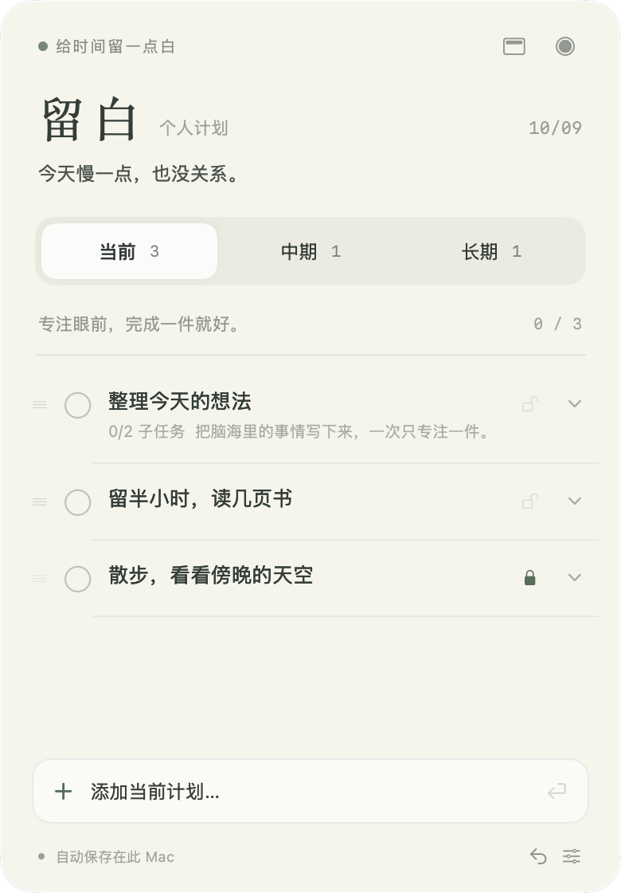
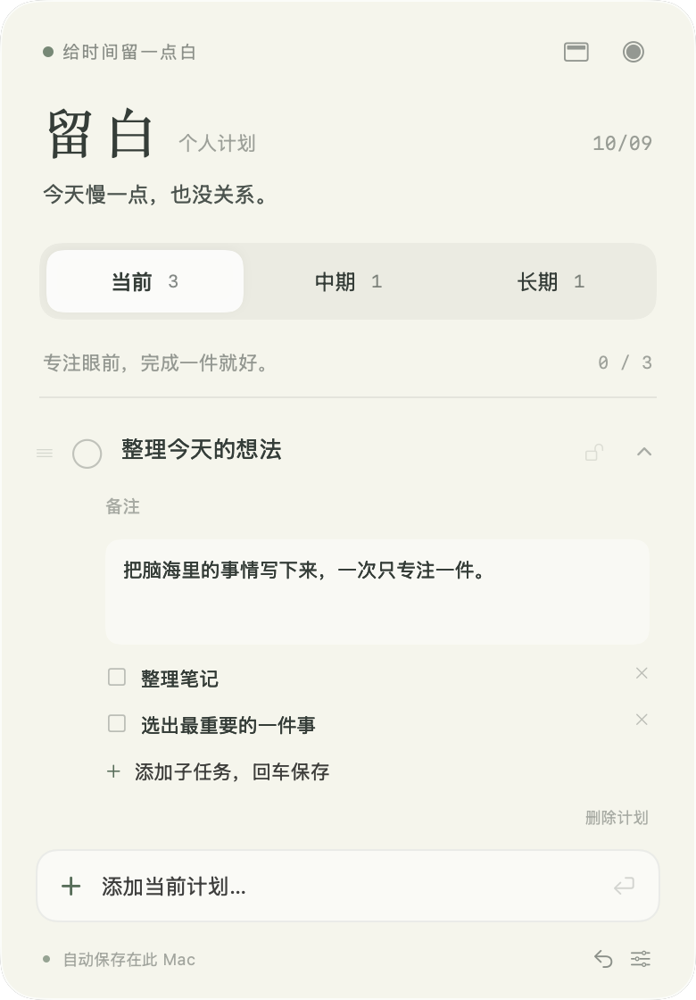

# 留白 · 给时间留一点白

一款轻量的 macOS 悬浮计划工具。把当前、中期和长期的待办分开放，写一句此刻的心情；需要时展开，不用时收成小圆点或屏幕顶部的收纳条。

**目前仅支持 macOS 13 及以上，不支持 Windows、Linux、iOS 或 Android。**

[下载最新版](https://github.com/zoroperona/liubai/releases/latest) · [反馈问题](https://github.com/zoroperona/liubai/issues)

## 看看留白

<p align="center">
  
  
</p>

<p align="center">
  
  &nbsp;&nbsp;&nbsp;
  
</p>

以上为应用实际窗口截图，全部使用虚构示例计划和心情；不包含真实用户数据或桌面内容。

## 能做什么

- **三段计划**：当前、中期、长期独立分页，显示未完成数量。
- **拖拽与锁定**：拖动左侧把手排序；锁定项在排序时保持原位置。
- **向下展开**：为计划补充备注和子任务，逐项勾选完成。
- **写下心情**：标题下方自由输入，支持多行、修改和清空。
- **半透明悬浮**：拖动顶部空白处移动窗口，从边缘调整大小，设置里调整背景浓度。
- **两种收纳**：40 × 40 点的小圆点，或屏幕顶部黑色收纳条。拖动圆点不会展开，单击松手才展开。
- **离线保存**：无需账号，无网络服务或分析 SDK，数据自动保存在自己的 Mac。

## 下载和安装

1. 前往 [Releases](https://github.com/zoroperona/liubai/releases/latest)，下载 `Liubai-v1.0.0-macOS-universal.zip`。
2. 解压后，将 `留白.app` 拖到「应用程序」文件夹，双击打开。
3. 应用通过菜单栏清单图标常驻，不显示 Dock 图标。

下载包包含 Apple Silicon（arm64）和 Intel（x86_64）两种架构。当前实际运行验证在 Apple Silicon Mac 上完成，Intel 和 macOS 13 尚未做真机验证。

当前版本使用 ad-hoc 签名，**尚未经过 Apple Developer ID 签名和公证**。首次打开可能被 macOS 拦截；确认下载来源是本仓库后，可在「系统设置 → 隐私与安全性」中选择「仍要打开」。也可以按下文从源码自行构建。

## 使用方法

| 操作 | 方法 |
| --- | --- |
| 添加计划 | 底部输入后按回车，`⌘N` 聚焦输入框 |
| 切换分页 | 点击当前 / 中期 / 长期，或 `⌘1 / ⌘2 / ⌘3` |
| 写心情 | 点击「留白」下方的提示文字直接输入 |
| 输入换行 | 心情、备注中使用 `⌥ Option + Return` |
| 编辑计划 | 点击标题，右侧箭头展开备注和子任务 |
| 完成计划 | 点击标题左侧的圆圈 |
| 拖拽排序 | 拖动最左侧三横线把手，放到目标任务上 |
| 锁定位置 | 点击锁图标；锁定后不能拖动或移到其他分页 |
| 移动分页 / 删除 | 右键任务；删除需确认 |
| 撤销 | 底部回转箭头，撤回最近一次修改 |
| 收起为圆点 | 面板右上角圆形按钮；单击圆点恢复 |
| 收纳到顶部 | 面板右上角顶部收纳按钮；点击黑色收纳条展开 |
| 调整透明度 | 右下角设置按钮 → 背景浓度 |
| 找回窗口 | Mac 屏幕顶部菜单栏的清单图标 → 打开计划面板 |
| **退出应用** | **Mac 屏幕顶部、时间和 Wi-Fi 附近的清单图标 → 退出留白** |

顶部展开后，鼠标离开约 1 秒自动收回；编辑文本或拖拽时保持展开。`Esc` 可立即收起。锁定仅控制排序，仍能编辑、完成和删除；删除其他任务可能改变锁定项的数字序号。

### 顶部收纳说明

“灵动岛”效果是应用自行绘制的悬浮收纳条，并非系统级灵动岛。有刘海的 Mac 放在摄像头遮挡区下缘，无刘海或外接显示器放在屏幕顶部中央。系统安全界面、全屏空间和多显示器行为受 macOS 控制。

## 数据与隐私

计划、子任务和心情仅保存在本机：

```text
~/Library/Application Support/PlanIsland/plans.json
```

窗口位置和背景浓度保存在本机应用偏好设置中。通过菜单栏「打开数据文件夹」可以备份数据；建议退出应用后复制 `plans.json`，恢复时退出应用再替换。

- 使用原子写入，保存失败时提示并保留上次状态。
- 数据损坏或版本不兼容时停止写入，避免覆盖原文件。
- 仓库与下载包不包含个人待办、心情、账号凭据或本机绝对路径。
- 截图来自独立临时示例数据；首次启动为空列表。
- 本地 JSON 没有额外加密，请按个人文件妥善保管。

## 从源码构建

需要 Mac 和 Xcode（含 Swift 5.9 或更新工具链）。原生 SwiftUI + AppKit，无第三方依赖。

```sh
git clone https://github.com/zoroperona/liubai.git
cd liubai
bash scripts/build-app.sh
open dist/留白.app
```

默认构建当前 Mac 的架构。构建 Apple Silicon + Intel 通用包：

```sh
bash scripts/build-app.sh --arch arm64 --arch x86_64
```

## 开发与验证

```sh
swift test
swift run PlanIsland
```

运行窗口检查和生成示例截图（需要已登录的 macOS 图形会话）：

```sh
swift build
.build/debug/PlanIsland --smoke-test
```

单元测试覆盖锁定排序、非法移动、心情持久化、旧数据兼容及损坏数据保护。窗口检查覆盖点击与拖动分离、拖回原位不展开、紧凑窗口尺寸和数据恢复，并将六张窗口截图和报告写入 `/tmp/PlanIsland-smoke/`。可通过 `PLAN_ISLAND_TEST_OUTPUT` 指定输出目录。

这些检查不代替真机鼠标操作、辅助功能、多显示器和不同 macOS 版本的完整验收。

| 目录 | 内容 |
| --- | --- |
| `Sources/PlanCore` | 数据模型、持久化、排序逻辑 |
| `Sources/PlanIsland` | 界面、窗口与菜单栏 |
| `Tests/PlanCoreTests` | 核心逻辑测试 |
| `scripts` | 应用打包和图标生成 |
| `docs/images` | 脱敏示例截图 |
